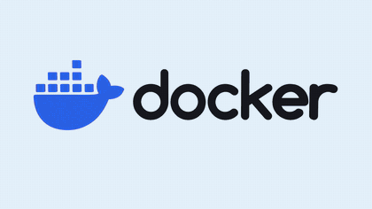

# Docker logo morph (Blender)



The old Docker logo turns 3D, the whale spins into the new Moby, and the new wordmark rises in. It starts and ends flat on the real logos. Full video: [preview.mp4](preview.mp4).

One Python script builds and renders the whole scene in Blender. There is no .blend file.

## How it works

- `prepare_outlines.py` reads Docker's SVGs, resamples the old whale body and the new whale to 480 points each, and lines the two up so the morph doesn't twist.
- `docker_morph.py` builds the whale as a curve with a shape key per logo, so one slider morphs old into new. The containers, letters, lights, camera and keyframes are all in code.
- Brand colors are the official hex values from Docker's brand page. The Standard view transform keeps them exact on the flat start and end frames.
- Cycles, 128 samples, 30 fps, motion blur.

## Run it

1. Install [Blender](https://www.blender.org/download/) (made with 5.3) and [uv](https://docs.astral.sh/uv/).
2. Get the logos: download the old and new Docker logo SVGs from [Docker's media resources page](https://www.docker.com/company/newsroom/media-resources/). Save the full old lockup (whale + wordmark) as `assets/docker/docker_old_full.svg` and the new one as `assets/docker/docker_new_full.svg`.
3. Get the studio light (CC0, Poly Haven):
   ```
   curl -o assets/studio_small_09.hdr https://dl.polyhaven.org/file/ph-assets/HDRIs/hdr/2k/studio_small_09_2k.hdr
   ```
4. Build the outlines:
   ```
   uv run --with svgpathtools python3 prepare_outlines.py
   ```
5. Render (270 frames into `frames/`) and encode:
   ```
   /Applications/Blender.app/Contents/MacOS/Blender -b --python docker_morph.py -- frames 128 1920 1080
   ffmpeg -framerate 30 -i frames/%04d.png -c:v libx264 -pix_fmt yuv420p docker-morph.mp4
   ```
   For a quick draft, try `frames 16 960 540 2`, which uses 16 samples, half size and every 2nd frame.

The script uses the Metal GPU, so it's set up for Apple Silicon. On another machine, change `compute_device_type` near the top to `CUDA` or `OPTIX`.

For the posted video, I also crossfaded the last 0.7 s into the flat official SVG, timed with the moment the 3D logo flattens. That step was done separately and isn't in this folder.

Docker, the Docker logo and Moby are trademarks of Docker, Inc. They aren't covered by this repo's MIT license, which is why the logo files aren't included here.
