# Motion Lab

Animations I build and post on X ([@purcelldev](https://x.com/purcelldev)), with the full source for each.

```
SwiftUI/<Name>/
  README.md     what it is + how to run
  preview.gif   plays right on GitHub
  preview.mp4   the full video from the post
  project.yml   XcodeGen project
  <Name>/       the Swift source
```

## SwiftUI

24 animations: 23 small iPhone apps and 1 Mac script (the dual-monitor koi). Real SwiftUI, no packages.

### Run one

1. Install [XcodeGen](https://github.com/yonaskolb/XcodeGen): `brew install xcodegen`
2. `cd SwiftUI/<Name>`, run `xcodegen`, then open the `.xcodeproj` and run.

Most need Xcode 26 / iOS 26 (Liquid Glass); a few run on iOS 17 or 18. Each folder's README says how to run it.

Many apps auto-play a scripted demo (a fake finger dot) for recording. Look for the `-demo` / `-reel` launch arguments at the top of the main file; without them you can drive it with your own finger.

### The animations

| Preview | Animation |
|---|---|
| [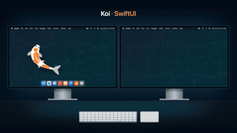](SwiftUI/KoiDualMonitor) | **[Koi across two Mac screens](SwiftUI/KoiDualMonitor)**<br>The koi swims behind the bezels from one monitor to the other. Renders the video offline (macOS script).<br>[post](https://x.com/purcelldev/status/2124586271444283703) · [full video](SwiftUI/KoiDualMonitor/preview.mp4) |
| [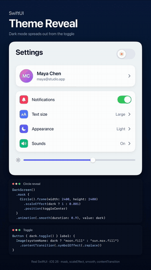](SwiftUI/ThemeReveal) | **[Dark mode circle reveal](SwiftUI/ThemeReveal)**<br>Dark mode spreads out from the toggle with a circle mask.<br>[post](https://x.com/purcelldev/status/2124210993211552140) · [full video](SwiftUI/ThemeReveal/preview.mp4) |
| [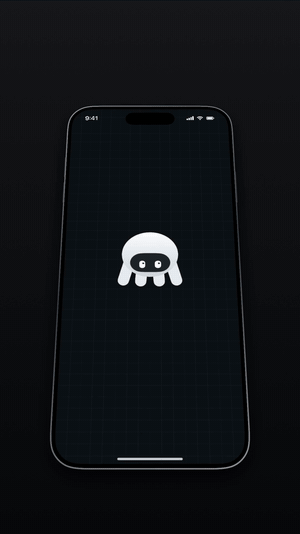](SwiftUI/SpriteSheetOctopus) | **[Octopus sprite sheet](SwiftUI/SpriteSheetOctopus)**<br>361 poses in one sheet; the octopus watches your finger and blends the 4 closest poses.<br>[post](https://x.com/purcelldev/status/2124055469513953761) · [full video](SwiftUI/SpriteSheetOctopus/preview.mp4) |
| [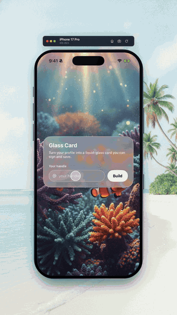](SwiftUI/GlassCardAndCylinder) | **[Liquid glass card + 3D cylinder carousel](SwiftUI/GlassCardAndCylinder)**<br>A draggable glass card that bends what's behind it (Metal layerEffect), and a trig photo cylinder you spin.<br>[post](https://x.com/purcelldev/status/2123707779508801901) · [full video](SwiftUI/GlassCardAndCylinder/preview.mp4) |
| [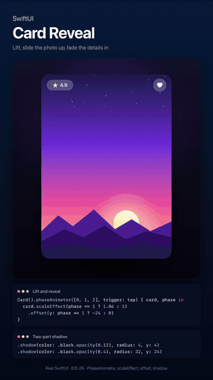](SwiftUI/CardReveal) | **[Card reveal](SwiftUI/CardReveal)**<br>Tap the card: it lifts, the photo slides up and the details fade in.<br>[post](https://x.com/purcelldev/status/2123589752180056488) · [full video](SwiftUI/CardReveal/preview.mp4) |
| [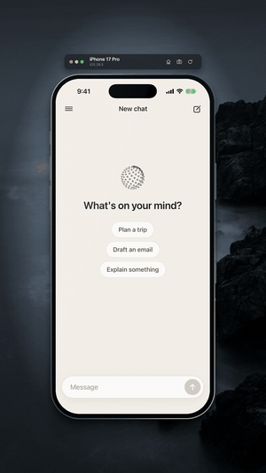](SwiftUI/ThinkingDotOrb) | **[AI thinking orb](SwiftUI/ThinkingDotOrb)**<br>Dots morph while it searches, reads and plans, then the result slides in with parallax.<br>[post](https://x.com/purcelldev/status/2123282030721167366) · [full video](SwiftUI/ThinkingDotOrb/preview.mp4) |
| [](SwiftUI/TiltParallax) | **[3D tilt collectible card](SwiftUI/TiltParallax)**<br>Every layer shifts by its depth; the shine moves the other way.<br>[post](https://x.com/purcelldev/status/2123148508438172115) · [full video](SwiftUI/TiltParallax/preview.mp4) |
| [](SwiftUI/LockScreen) | **[Lock screen remake](SwiftUI/LockScreen)**<br>The clock hides behind the mountain and notifications stack in.<br>[post](https://x.com/purcelldev/status/2123148270239416564) · [full video](SwiftUI/LockScreen/preview.mp4) |
| [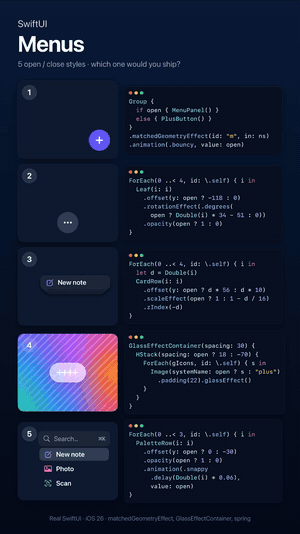](SwiftUI/Menus) | **[5 ways to open a menu](SwiftUI/Menus)**<br>Morphing plus, popover fan, stacked cards, gooey Liquid Glass and a command palette.<br>[post](https://x.com/purcelldev/status/2123043454720868562) · [full video](SwiftUI/Menus/preview.mp4) |
| [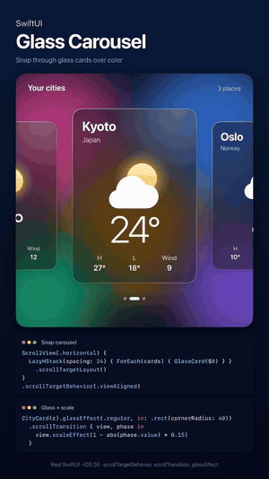](SwiftUI/GlassCarousel) | **[Liquid glass weather cards](SwiftUI/GlassCarousel)**<br>Glass weather cards that snap as you swipe.<br>[post](https://x.com/purcelldev/status/2123043331546685729) · [full video](SwiftUI/GlassCarousel/preview.mp4) |
| [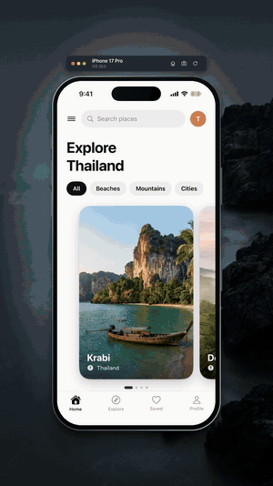](SwiftUI/ParallaxCarousel) | **[Parallax carousel](SwiftUI/ParallaxCarousel)**<br>The photo slides slower than the card; one visualEffect does it.<br>[post](https://x.com/purcelldev/status/2122811366650364387) · [full video](SwiftUI/ParallaxCarousel/preview.mp4) |
| [](SwiftUI/Lizard) | **[Lizard that follows your finger](SwiftUI/Lizard)**<br>Each bone follows the one in front; the legs use 2-bone IK and step when they fall behind.<br>[post](https://x.com/purcelldev/status/2122786869515849993) · [full video](SwiftUI/Lizard/preview.mp4) |
| [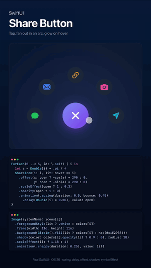](SwiftUI/ShareFan) | **[Share button fan](SwiftUI/ShareFan)**<br>5 buttons fan out in an arc, each a few ms after the last.<br>[post](https://x.com/purcelldev/status/2122785542400307455) · [full video](SwiftUI/ShareFan/preview.mp4) |
| [](SwiftUI/UploadHoop) | **[Upload free throw](SwiftUI/UploadHoop)**<br>Flick the file, it arcs into the hoop, the net wiggles and the count ticks up.<br>[post](https://x.com/purcelldev/status/2122761304918429988) · [full video](SwiftUI/UploadHoop/preview.mp4) |
| [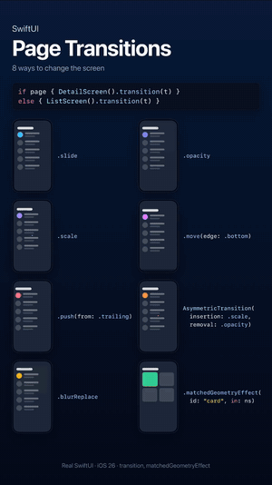](SwiftUI/Transitions) | **[8 screen transitions](SwiftUI/Transitions)**<br>.slide, .opacity, .scale, .move, .push, asymmetric, .blurReplace and matchedGeometryEffect.<br>[post](https://x.com/purcelldev/status/2122702749985128820) · [full video](SwiftUI/Transitions/preview.mp4) |
| [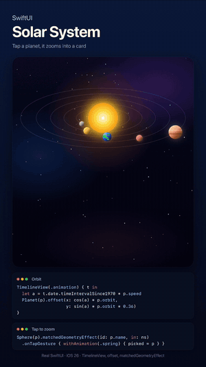](SwiftUI/SolarSystem) | **[Tiny solar system](SwiftUI/SolarSystem)**<br>Tap Earth and it flies into a card.<br>[post](https://x.com/purcelldev/status/2122701257186128082) · [full video](SwiftUI/SolarSystem/preview.mp4) |
| [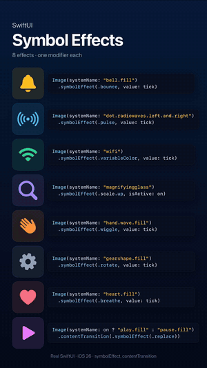](SwiftUI/SymbolEffects) | **[8 SF Symbol effects](SwiftUI/SymbolEffects)**<br>.bounce, .pulse, .variableColor, .scale, .wiggle, .rotate, .breathe and .replace.<br>[post](https://x.com/purcelldev/status/2122561573042688118) · [full video](SwiftUI/SymbolEffects/preview.mp4) |
| [](SwiftUI/AnimationCurves) | **[Animation curves](SwiftUI/AnimationCurves)**<br>linear, easeIn, easeOut, easeInOut, spring, bouncy and snappy, one by one.<br>[post](https://x.com/purcelldev/status/2122262272345255989) · [full video](SwiftUI/AnimationCurves/preview.mp4) |
| [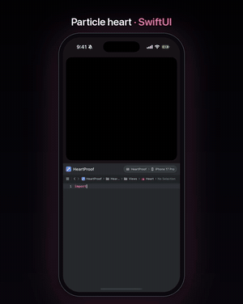](SwiftUI/ParticleHeart) | **[3,000-particle heart](SwiftUI/ParticleHeart)**<br>Particles swirl into the classic heart curve with TimelineView + Canvas.<br>[post](https://x.com/purcelldev/status/2122198880985182243) · [full video](SwiftUI/ParticleHeart/preview.mp4) |
| [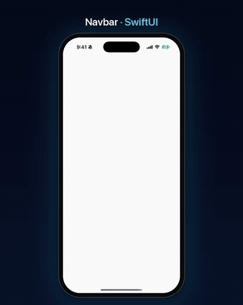](SwiftUI/GlassNavbar) | **[Glass navbar](SwiftUI/GlassNavbar)**<br>A pill slides between tabs with matchedGeometryEffect and a bouncy spring.<br>[post](https://x.com/purcelldev/status/2121817792148332557) · [full video](SwiftUI/GlassNavbar/preview.mp4) |
| [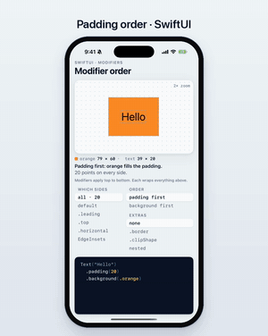](SwiftUI/ModifierOrder) | **[Modifier order](SwiftUI/ModifierOrder)**<br>.padding() then .background() vs the other way round.<br>[post](https://x.com/purcelldev/status/2121609229303955912) · [full video](SwiftUI/ModifierOrder/preview.mp4) |
| [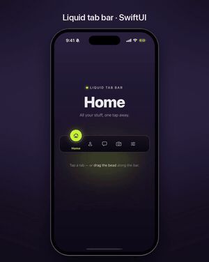](SwiftUI/LiquidTabBar) | **[Liquid tab bar](SwiftUI/LiquidTabBar)**<br>A bead floats on the bar and the edge dips under it like water.<br>[post](https://x.com/purcelldev/status/2121509813670777080) · [full video](SwiftUI/LiquidTabBar/preview.mp4) |
| [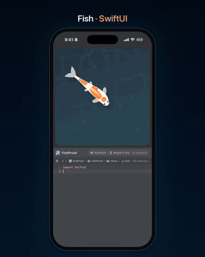](SwiftUI/Koi) | **[Koi that follows your finger](SwiftUI/Koi)**<br>14 spine points, each joint bends at most ~20 degrees, so the body stays one smooth curve.<br>[post](https://x.com/purcelldev/status/2121492929021915248) · [full video](SwiftUI/Koi/preview.mp4) |
| [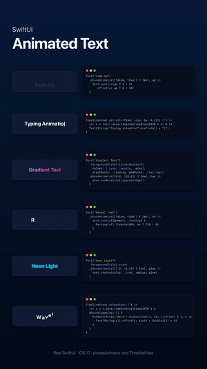](SwiftUI/AnimatedText) | **[Animated text, 6 ways](SwiftUI/AnimatedText)**<br>Six text animation styles.<br>[post](https://x.com/purcelldev/status/2121248596200996962) · [full video](SwiftUI/AnimatedText/preview.mp4) |

## License

MIT. Use them in your apps. A link back is appreciated, not required.
