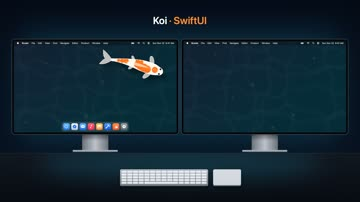

# Koi across two Mac screens

The koi swims behind the bezels from one monitor to the other. Renders the video offline (macOS script).



- Video: [preview.mp4](preview.mp4)
- Original post: https://x.com/purcelldev/status/2124586271444283703

## Run

```sh
swiftc -O Fish.swift main.swift -o koi && ./koi koi.mp4  (needs ffmpeg)
```
