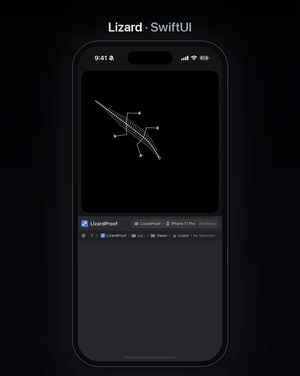

# Lizard that follows your finger

Each bone follows the one in front; the legs use 2-bone IK and step when they fall behind.



- Full video: [preview.mp4](preview.mp4)
- Original post: https://x.com/purcelldev/status/2122786869515849993

## Run

```sh
xcodegen && open *.xcodeproj
```
